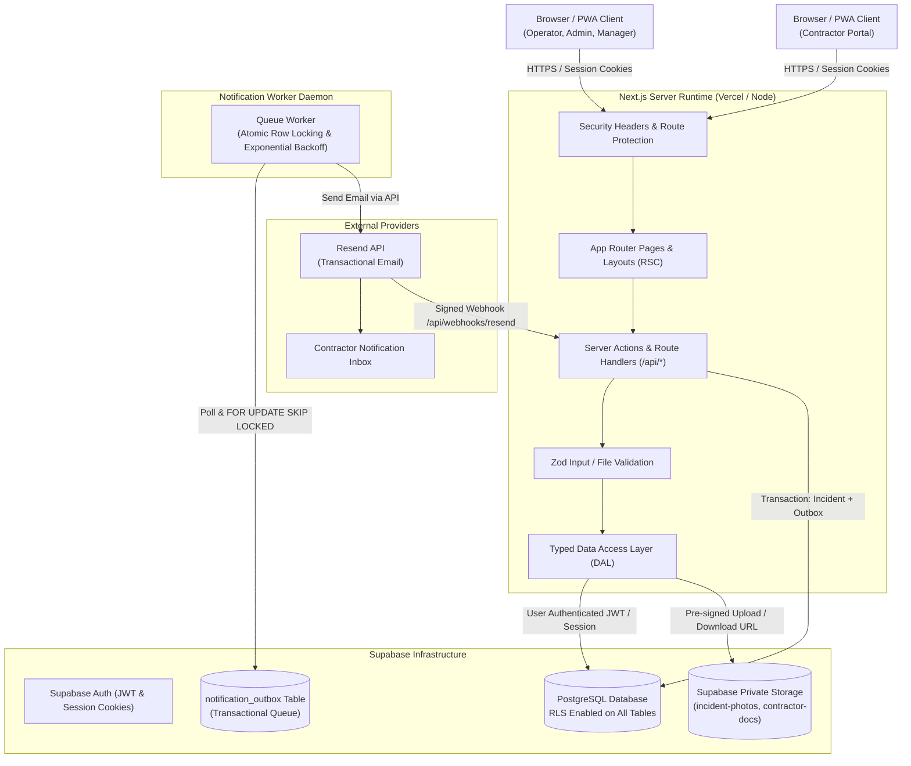

# Architecture & Trust Boundaries
## TownSquare Control — Security Operations & Incident Management Platform

---

## 1. System Overview

TownSquare Control is engineered using a defense-in-depth, three-tier architecture separating the browser client, Next.js server runtime, Supabase managed services, and third-party transactional email providers.

---

## 2. Trust Boundaries & Data Flow

### Trust Boundary 1: Browser to Next.js Server
- **Untrusted:** All incoming HTTP requests, headers, cookies, query parameters, and form bodies.
- **Controls:**
  - Strict Content Security Policy (CSP), HSTS, X-Frame-Options: DENY, X-Content-Type-Options: nosniff.
  - Server-side session verification via `@supabase/ssr`.
  - Comprehensive Zod validation on every Server Action and Route Handler.
  - Rate limiting on public and sensitive endpoints (Auth, Incident Creation, File Upload).
  - No authorization decisions made on the client.

### Trust Boundary 2: Next.js Server to Supabase PostgreSQL
- **Trust Level:** Authenticated scoped client.
- **Controls:**
  - Client queries execute using the authenticated user's JWT (`supabaseUserClient`), subject directly to PostgreSQL Row-Level Security (RLS).
  - Privileged actions (e.g. system maintenance, account creation, outbox queue claiming) use isolated server-side `supabaseAdminClient` with explicit server-level authorization checks.
  - RLS policies fail closed (`RESTRICTIVE` or zero permissive match denies access).

### Trust Boundary 3: Next.js Server to Supabase Storage
- **Trust Level:** Authenticated pre-signed URLs.
- **Controls:**
  - Buckets are 100% PRIVATE (`public = false`).
  - Upload paths are generated server-side using cryptographically secure UUIDs (`incident_id/attachment_id-sanitized.ext`).
  - Downloads require server-generated, short-lived (e.g., 15-minute) signed URLs, authorized per incident ownership.
  - File magic-bytes and MIME types are verified server-side.

### Trust Boundary 4: Asynchronous Notification Worker & Resend
- **Trust Level:** Server-to-server TLS with API keys.
- **Controls:**
  - Incident creation and outbox queuing occur within a single database transaction. An email failure never aborts or rolls back a valid incident record.
  - The worker uses atomic row locking (`SELECT ... FOR UPDATE SKIP LOCKED`) to ensure exactly-once processing across concurrent worker instances.
  - Idempotency keys prevent duplicate email dispatch during network retries.
  - Webhooks from Resend are verified with cryptographic signature verification (HMAC).

---

## 3. Directory Layout & Separation of Concerns

To satisfy strict modular separation:
- **`client/`**: Contains the full Next.js App Router application.
  - `src/app/`: Client & server routes organized by role (`(auth)`, `(dashboard)`, `(contractor)`, `(admin)`, `api/`).
  - `src/components/`: Reusable UI components, design tokens, responsive tables, forms, and timeline visualizers.
  - `src/lib/`: Client utilities, i18n dictionary loaders, client-safe schemas.
  - `src/server/`: Dedicated Server-Side Data Access Layer (DAL), server action handlers, Supabase server clients, and security utilities.
- **`server/`**: Dedicated backend migration engine, background worker daemon, and automated test runners.
  - `migrations/`: Sequential SQL migrations applying table schemas, foreign keys, constraints, and RLS policies.
  - `seeds/`: Initial deterministic seed records (Town Square community, Zones 1–4, default categories).
  - `worker/`: Standalone background outbox processor service with graceful shutdown and jittered exponential backoff.
  - `tests/`: End-to-end RLS isolation tests, security penetration scripts, and integration tests.
